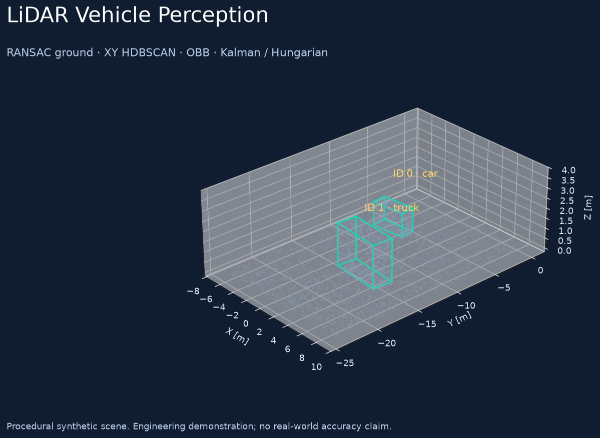

# LiDAR Vehicle Perception

[](https://github.com/Maxi-online/lidar-vehicle-perception/actions/workflows/ci.yml)
[](LICENSE)

**Geometric vehicle proposals, dimensions and multi-object tracking from 3D point clouds.**
Headless offline replay, an optional ROS 2 adapter, reproducible procedural data,
layout-aware PointCloud2 decoding and a matching-based evaluation baseline.

[Описание на русском](README.ru.md) · [Architecture](docs/architecture.md) ·
[Evaluation](docs/evaluation.md) · [ROS 2](docs/ros2.md) · [Provenance](docs/provenance.md)



The image is generated from the pipeline's detections and confirmed tracks.
The input is synthetic cuboid surface points, not a real LiDAR recording.

## What is implemented

- Finite XYZ filtering and configurable installation-specific ROI.
- RANSAC ground removal with a ground-normal constraint.
- HDBSCAN clustering in XY with configurable fragmentation control.
- Gravity-aligned oriented boxes, dimensions and geometric filtering.
- Constant-velocity Kalman tracking with distance-gated Hungarian assignment.
- Explicit track confirmation, coasting and expiration.
- PCD / NPY / NPZ replay, JSONL outputs and a self-contained interactive HTML replay.
- An optional PointCloud2-to-JSON ROS 2 adapter; no ROS imports in the offline package.
- AABB-BEV matching evaluation with TP/FP/FN, dimension error and matched-track ID changes.

This is a geometric engineering prototype. It does not require model weights,
GPU inference, API keys or a trained neural classifier. Vehicle class labels are
dimension rules. ROS integration and field accuracy are not established by the
synthetic demonstration.

## Quick start

Python **3.10–3.12**. The local release verification used Windows / Python 3.11;
the CI workflow checks Linux / Python 3.10, 3.11 and 3.12.

Linux:

```bash
git clone https://github.com/Maxi-online/lidar-vehicle-perception.git
cd lidar-vehicle-perception
python3.11 -m venv .venv
. .venv/bin/activate
python -m pip install -e .
OMP_NUM_THREADS=2 OPENBLAS_NUM_THREADS=1 lidar-perception demo --output artifacts/demo
```

Windows PowerShell:

```powershell
git clone https://github.com/Maxi-online/lidar-vehicle-perception.git
cd lidar-vehicle-perception
py -3.11 -m venv .venv
& .venv/Scripts/python.exe -m pip install -e .
$env:OMP_NUM_THREADS='2'
$env:OPENBLAS_NUM_THREADS='1'
& .venv/Scripts/python.exe -m lidar_vehicle_perception demo --output artifacts/demo
```

Open `artifacts/demo/replay.html` in a browser and use Play or the frame slider.
Plotly is embedded; the generated HTML does not need a CDN. The demo also writes
`predictions.jsonl`, `evaluation.json`, `summary.json` and `preview.png`, with
the generated point clouds and `ground_truth.jsonl` inside `inputs/`.

The synthetic input directory must be empty. Use another output directory for a
second run; existing input sequences are not deleted or silently mixed.

## Demonstration results and their scope

The default seeded demo contains **12 frames, 4,300 points per frame and two
procedural vehicles**. In the recorded run, all 24 generating boxes were matched
at **AABB-BEV IoU ≥ 0.3**, with zero false positives and zero false negatives.
There were zero identity changes across 20 matched confirmed-track observations;
the first two frames precede track confirmation.

These are **synthetic software-fixture results, not real-world accuracy or a
generalization benchmark**. The fixture lacks realistic beams, clutter,
occlusion, materials and class diversity. Configuration development used
synthetic scenes. Raw measured values, dimensions, timing scope and environment
are saved in [demo-evaluation.json](docs/demo-evaluation.json) and
[demo-summary.json](docs/demo-summary.json). See [validation](docs/validation.md).

## Process your own clouds

After generating the demo, the following commands exercise the same IO and
evaluation paths used for local PCD datasets:

```bash
lidar-perception run --input artifacts/demo/inputs --output artifacts/replay --config configs/default.json --fps 10 --max-frames 12 --html
lidar-perception evaluate --predictions artifacts/replay/predictions.jsonl --ground-truth artifacts/demo/inputs/ground_truth.jsonl --output artifacts/replay/evaluation.json
```

`--input` accepts one file or a directory containing `.pcd`, `.npy` or `.npz`
files. For NPZ, the array key is `points`. Input must be numeric XYZ in metres,
Z-up, without ego-motion. Files are processed in lexical relative-path order at
nominal `--fps`; source timestamps are not inferred. The default limit is 60
frames; `--max-frames 0` processes all. HTML retains only the first 60 frames.
Configure ROI and dimension bounds for your installation before drawing conclusions.

Predictions contain detector proposals separately from confirmed tracks. Track
records expose `track_id`, `observed` and `missed_frames`; coasting predictions
are distinguishable from new observations. Box geometry is `center`, `extent`,
`rotation` and derived `corners`. No fabricated confidence probabilities are emitted.

## Design trade-offs

XY clustering joins height layers of one vehicle, but can merge nearby objects.
Gravity-aligned boxes make dimensions easier to interpret, but require an
appropriate coordinate frame. Fixed size rules are explainable and need no
training data, but cannot reliably distinguish all objects with similar geometry.
Kalman/Hungarian tracking is compact, but does not solve appearance ambiguity or
severe occlusion. Experimental shadow completion is off by default because it
adds assumed, unobserved geometry.

The original desktop prototype combined ROS, processing threads and Panel UI at
import time. This release separates detector, tracker, adapters and artifact
rendering, fixes association gating and binary cloud decoding, and replaces a
detection-count script with an explicit matching evaluator. The original
algorithmic lineage and release changes are documented in [provenance](docs/provenance.md).

## Development

```bash
python -m pip install -e '.[dev]'
PYTEST_DISABLE_PLUGIN_AUTOLOAD=1 OMP_NUM_THREADS=2 python -m pytest -q
python -m ruff check src tests
python -m build
```

Tests cover the actual detector on procedural point clouds, association gating,
ID persistence through a short occlusion, track expiration, padded/endian
PointCloud2 input, invalid geometry, missing/extra evaluation frames and a full
CLI demo. They do not substitute for independently labelled field data.

`requirements-lock-py311-windows.txt` records the exact local Windows/Python 3.11
verification environment including development and transitive dependencies.
Use `requirements.txt` / `pyproject.toml` for the declared portable dependency
ranges; the Windows lock is not a cross-platform Python 3.10 lock.

Optional offline container command, supplied for convenience:

```bash
docker build -t lidar-vehicle-perception .
docker run --rm -v "${PWD}/artifacts:/artifacts" lidar-vehicle-perception demo --output /artifacts/container-demo
```

Container execution and live ROS operation are outside the recorded local checks.

## License and attribution

MIT © 2026 Maxi-online. Source datasets, thermal recordings, binaries and model
weights are not distributed. Open3D, HDBSCAN, NumPy, SciPy, FilterPy, Plotly and
their dependencies retain their own licenses. This project integrates established
algorithms; it makes no novel-model or state-of-the-art performance claim.

## Configuration, privacy and reproducibility

The offline demonstration uses procedural point clouds and requires no cloud AI credentials. Real PCD files and ROS bags can contain routes and acquisition metadata; keep them outside Git until publication rights and an anonymized dataset are established. Synthetic replay metrics and a real-PCD smoke check are not a road-dataset accuracy evaluation.

Keep credentials in ignored local files or environment variables. Configuration examples contain structure only. Avoid passing secrets on the command line or committing populated `.env` files, private keys, databases or logs.

The [Secret scan](.github/workflows/secret-scan.yml) workflow scans current files and incoming commits with Gitleaks 8.30.1 and redacts matched values. Pattern scanning cannot prove that every possible disclosure is absent. Removing a value from HEAD does not clean older history; see [SECURITY.md](SECURITY.md) for incident handling.
