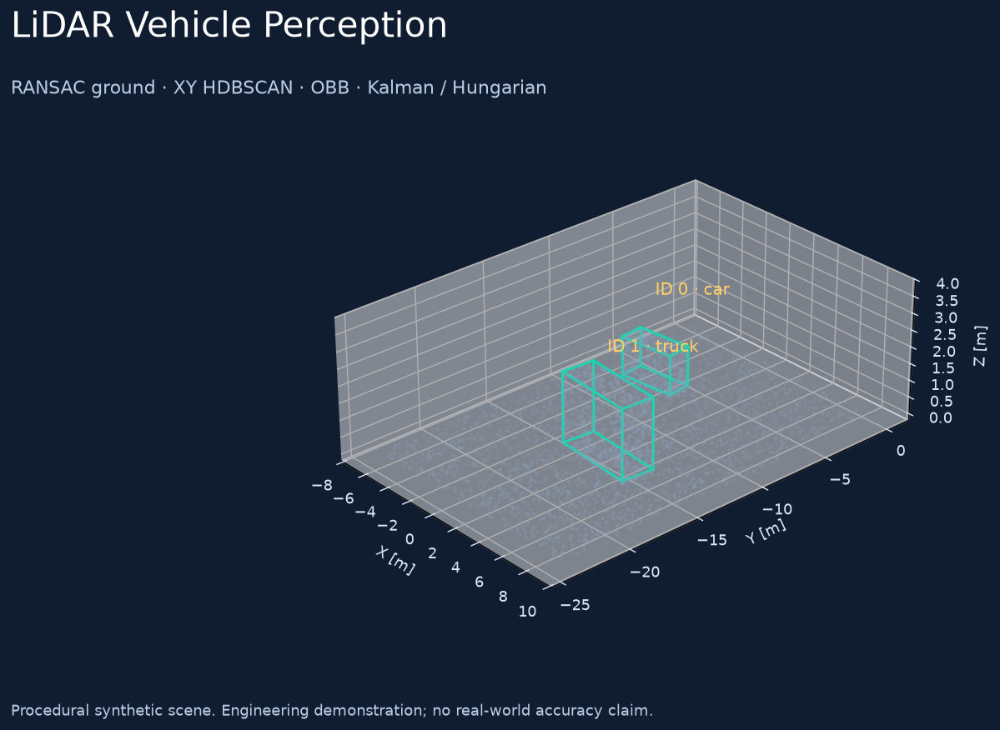

# LiDAR Vehicle Perception

Геометрический конвейер выделения транспорта и сопровождения объектов в облаках
точек. Основан на собственной системе `detect_vehicles`; публичная версия
разделяет обработку, трекинг, ввод данных и визуализацию.



Реализованы ROI, удаление земли RANSAC, кластеризация HDBSCAN в XY, ориентированные
по вертикали боксы, габариты, фильтрация и Kalman/Hungarian-трекинг. Есть запуск
без ROS2 на PCD/NPY/NPZ, синтетическая последовательность с разметкой, интерактивное
HTML-воспроизведение и необязательный ROS2-адаптер.

## Запуск в PowerShell

Нужен Python 3.10–3.12; локальная проверка выполнялась на Python 3.11.

```powershell
git clone https://github.com/Maxi-online/lidar-vehicle-perception.git
cd lidar-vehicle-perception
py -3.11 -m venv .venv
& .venv/Scripts/python.exe -m pip install -e .
$env:OMP_NUM_THREADS='2'
$env:OPENBLAS_NUM_THREADS='1'
& .venv/Scripts/python.exe -m lidar_vehicle_perception demo --output artifacts/demo
```

Открой `artifacts/demo/replay.html`: кнопка Play и ползунок показывают облако,
детекции и подтверждённые ID. HTML содержит Plotly и не требует CDN.
JSONL сохраняет боксы и треки отдельно. В `evaluation.json` — сопоставление с
разметкой; в `summary.json` — конфигурация, версии зависимостей и время обработки.

Синтетическое демо — 12 кадров, по два объекта. В сохранённом запуске сопоставлены
все 24 бокса при AABB-BEV IoU ≥ 0.3. Это проверка программного конвейера на
процедурных кубоидах, **не оценка точности на реальном дорожном потоке**.
Классы определяются габаритными правилами; обученная нейросетевая классификация
в этот релиз не входит. Размеры и ROI нужно настраивать под установку.

Проверены обработка синтетических облаков, сохранение ID, краткое пропадание
детекций, выбраковка невозможных ассоциаций, форматы PointCloud2 и полный запуск
CLI. Живая интеграция ROS2, контейнер и аппаратная эксплуатация не подтверждены.

Подробности: [основной README](README.md), [архитектура](docs/architecture.md),
[методика оценки](docs/evaluation.md), [происхождение и изменения](docs/provenance.md).

MIT © 2026 Maxi-online. Исходные записи и веса в репозиторий не включены.
