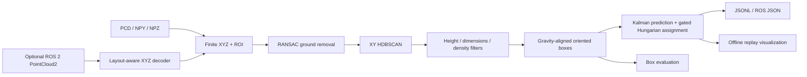

# Architecture and engineering decisions

The first implementation combined perception, ROS subscription, queues, tracking
and Panel widgets in one import-time application. This publication separates the
pipeline so the detector and tracker can run without a UI, ROS installation or
network access.

## Perception

Input is XYZ in metres in a gravity-aligned, Z-up frame. ROI settings are
installation-specific; the default reproduces the prototype's monitored area.
Up to two dominant planes are inspected so a wall is not automatically accepted
as ground. The normal must be sufficiently close to the vertical axis.

Clustering uses XY rather than XYZ to keep different height layers of one vehicle
together. HDBSCAN's selection epsilon defaults to 0.5 m to reduce fragmentation
of nonuniformly sampled vehicle surfaces. This is a scene-dependent trade-off:
nearby vehicles can merge. There is no universal separation guarantee.

The public version uses the minimum-area rectangle of the XY convex hull and
world-Z height. This avoids the roll/pitch ambiguity of unconstrained 3D PCA boxes
on sparse side surfaces. It assumes gravity alignment and does not recover hidden
geometry. Sparse visible points can underestimate dimensions.

Size labels (`car`, `minivan`, `truck`, `unknown`) are upper-bound heuristics, not
the output of a trained neural classifier. The original PointNet/GPT4All helper
is not part of this pipeline. No weights, model downloads or API keys are required.

An experimental ray-based ground shadow completion is available through
`reconstruct_shadow`; it is disabled by default. It can overestimate length and
width and is not a physically validated reconstruction method.

## Tracking

State is `[x, y, z, vx, vy, vz]`; observations are XYZ centers. Prediction uses the
provided positive finite `dt`. Distance gating is applied before assignment so an
out-of-gate pair cannot consume a valid assignment. Covariances are fixed prototype
settings; uncertainty calibration, ego-motion compensation, appearance matching
and difficult crossing trajectories are not established by this release.

Tracks become visible after `min_hits` total observations. Unobserved tracks may
coast for `max_age` frames and carry `observed=false`; their boxes translate with
the predicted center. Evaluation excludes these predicted-only boxes from the
observed-track matching count. Track orientation and dimensions use the most
recent associated proposal rather than a separate shape-state model.

## IO and runtime boundaries

Offline files are processed in lexical relative-path order with nominal constant
frame spacing `1/fps`. Acquisition timestamps are not inferred from filenames.
The reader accepts PCD via Open3D and numeric NPY/NPZ with `allow_pickle=False`.
Corrupt/empty PCD input fails clearly. Only finite XYZ points enter perception.

The optional ROS 2 adapter uses message timestamps and rejects non-increasing
timestamps. Its binary decoder respects XYZ field offsets, point/row padding,
FLOAT32/FLOAT64 and endianness. Subscription uses best effort and depth one:
processing may drop frames instead of accumulating an unlimited backlog. ROS
integration is supplied as an adapter and has not been verified on a live ROS graph.

Offline results are JSONL. Visualization is an output consumer, not detector
state. The HTML replay embeds Plotly and works without a CDN. At most the first
60 frames are retained for HTML visualization, keeping a large replay's preview
memory bounded. Docker configuration is included but a container run is not
claimed unless explicitly recorded in validation.
