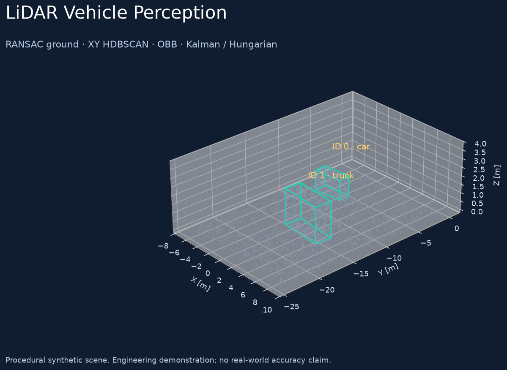

# LiDAR Vehicle Perception: quickstart

A geometric pipeline for vehicle proposals and object tracking in point clouds,
derived from the author's `detect_vehicles` system. Processing, tracking, input
adapters and visualization are separate modules.



The implementation includes region-of-interest filtering, RANSAC ground removal,
HDBSCAN clustering in the XY plane, upright bounding boxes, dimension estimates,
geometric filtering and Kalman/Hungarian tracking. It supports headless replay
of PCD/NPY/NPZ data, a labeled synthetic sequence, interactive HTML replay and an
optional ROS 2 adapter.

## Run in PowerShell

Use Python 3.10–3.12. Local verification used Python 3.11.

```powershell
git clone https://github.com/Maxi-online/lidar-vehicle-perception.git
cd lidar-vehicle-perception
py -3.11 -m venv .venv
& .venv/Scripts/python.exe -m pip install -e .
$env:OMP_NUM_THREADS='2'
$env:OPENBLAS_NUM_THREADS='1'
& .venv/Scripts/python.exe -m lidar_vehicle_perception demo --output artifacts/demo
```

Open `artifacts/demo/replay.html`. The Play control and frame slider display
point clouds, detections and confirmed track IDs. Plotly is embedded in the HTML;
the replay does not require a CDN. JSONL files keep detections and tracks
separate. `evaluation.json` records matching against labels; `summary.json`
records configuration, dependency versions and processing time.

## Interpret the demonstration

The saved synthetic example contains 12 frames with two objects per frame.
All 24 boxes were matched at AABB-BEV IoU ≥ 0.3 in that recorded run. This checks
the pipeline on procedural cuboids; it does not establish real-traffic accuracy.
Classification uses dimension rules rather than a trained neural classifier.
ROI and size thresholds require calibration for the installation.

Tests cover synthetic clouds, ID continuity, brief detection gaps, rejection of
implausible associations, PointCloud2 layouts and the complete CLI. Live ROS 2,
container deployment and operation on hardware remain unverified.

See the [main README](../README.md), [architecture](architecture.md),
[evaluation protocol](evaluation.md) and [provenance](provenance.md).

MIT © 2026 Maxi-online. Original recordings and model weights are not included.
